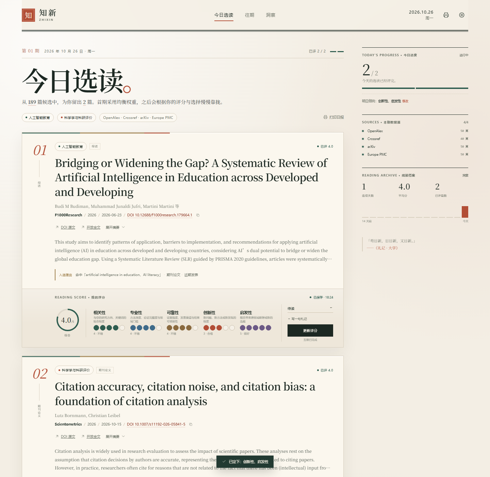
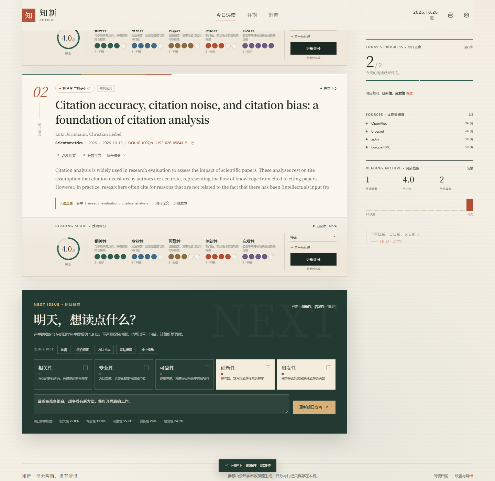
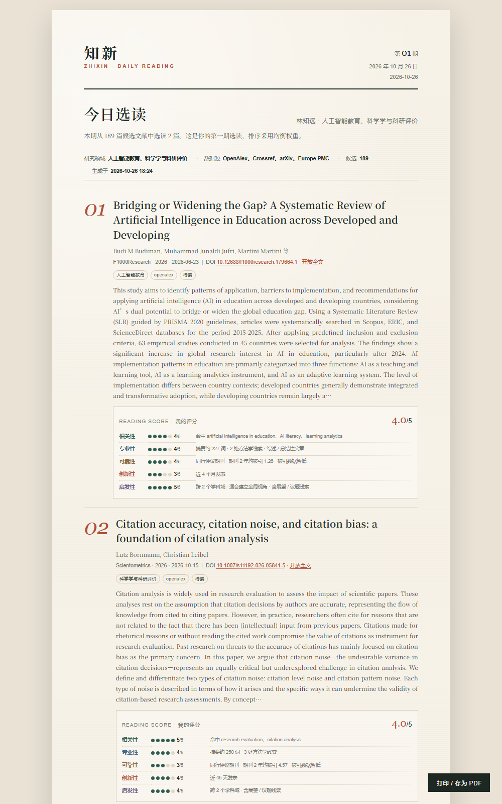

# 知新 · 文献日报

[](https://github.com/JiajunXie-0519/zhixin-litdaily/actions/workflows/tests.yml) [](LICENSE) [GitHub](https://github.com/JiajunXie-0519/zhixin-litdaily)

> v1.1.0 · 本地优先 · 无第三方依赖 · [MIT License](LICENSE) · [更新日志](CHANGELOG.md)

每天从公开学术数据源里挑 **1–5 篇**值得读的文献，读完用五个维度打分，再告诉它明天想读什么。它会把你今天的判断变成明天的排序权重。

- 纯 Python 标准库，**不需要 `pip install`**
- 数据只保存在本机 `data/state.json`
- 双击 `start.bat` 即用，浏览器自动打开
- 可增删研究领域、切换数据源、导出 CSV / 完整备份 / 可打印日报
- 自动把阅读记录同步到 **Obsidian**：每篇文献一篇笔记、每天一篇日报、一个总索引
- 读取本机 **Zotero** 阅读状态，避开已读/在读文献，并用已读标签、期刊改进推荐
- 支持填写学校图书馆的 EZproxy 入口，用高校订阅查看全文（不保存账号密码）



---

## 1. 快速开始

### Windows

1. 安装 [Python 3.10+](https://www.python.org/downloads/)，安装时勾选 **Add Python to PATH**。
2. 双击文件夹里的 **`start.bat`**。它会在后台启动服务并自动打开浏览器，**不会留下需要 Ctrl+C 的命令窗**。
3. 首次打开会进入引导：填写研究方向、英文检索词，选择每天 1–5 篇。
4. 约 10–20 秒后生成今日选读。

再次双击 `start.bat` 会直接打开已经在运行的那一份，不会重复启动。端口被占用时会自动顺延，浏览器地址由程序自己处理。

**关闭浏览器不会丢数据**，服务会在后台待命；下次双击即可秒开。

### 停止

- 页面右上角 **电源按钮** → 退出知新（推荐）。
- 或双击 **`stop.bat`**。
- 如果启动异常、想看详细日志，双击 **`start-console.bat`**，或查看 `data/server.log`。

### macOS / Linux

```bash
cd 文献日报
python3 app.py
```

浏览器打开终端显示的地址；停止时在终端按 `Ctrl+C`（Linux 版目前保留前台运行）。

---

## 2. 每天怎么用

1. **读**：今日选读给出标题、作者、期刊、DOI、摘要和“入选理由”。
2. **评**：五个维度各打 1–5 分，可加阅读状态和一句札记。
3. **定方向**：至少评完一篇后，“明日倾向”解锁。点选更想看的维度（可多选），保存。
4. **第二天**：打开应用，生成今日选读时会自动读取你昨天定下的偏好，并把对应维度权重提高约 **1.9 倍**。

不需要手动点击“保存日报”。每次打分和偏好都会即时写入本地状态文件；`打印日报` 会打开一份可独立打印/存 PDF 的 A4 报表。





### 五个评分维度

| 维度 | 你判断什么 | 推荐排序里的可解释代理 |
|---|---|---|
| 相关性 | 与你的研究方向、关键词是否贴合 | 标题/摘要/主题词命中、领域归属 |
| 专业性 | 方法、论证和领域门槛 | 摘要信息量、方法学线索、综述/论文类型 |
| 可靠性 | 证据强度、发表渠道、可核验性 | DOI、同行评议渠道、被引、多源交叉、期刊 2 年均被引 |
| 创新性 | 新问题、新方法、新发现 | 新鲜度、被引速度、新意措辞 |
| 启发性 | 跨领域联想、新选题 | 跨学科域、综述属性、展望/议题线索 |

评分是**你的判断**；排序用的是同名启发式代理。两者不混在一起，日报会把每篇的推荐依据摊开给你看。

---

## 3. 研究领域与检索词

在右上角齿轮 → **研究领域** 中可以随时新增、编辑或删除领域，最多 6 个。

- **名称**可以写中文，用于日报展示。
- **英文检索词**用于检索，建议 2–6 个具体词，用逗号分隔。
- 示例：
  - 人工智能教育：`artificial intelligence in education, AI literacy, learning analytics`
  - 科学学与科研评价：`research evaluation, open science, citation analysis`
  - 计算社会科学：`computational social science, social network analysis, text as data`

多领域会一起检索；每天 1–5 篇时会优先兼顾不同领域，避免某一天被同一个方向占满。检索时会按日期轮转领域顺序，让不常出现的领域也有机会进入候选。

修改领域或关键词是即时保存的，但只影响**下一次生成**：今天已经生成的选读不会被悄悄替换。若今天还没有评分，可以在设置底部点“按当前设置重选今天”；如果已经评分，今天的日报保持不变，新设置从明天开始生效。

> 中文检索词不是不能用，但 OpenAlex / Crossref / arXiv 对中文的覆盖远弱于英文，建议至少保证每个领域有一组英文检索词。应用会阻止完全没有英文的检索词提交。

---

## 4. 文献源与“尽可能全面”

默认同时启用四个**免 Key** 数据源：

| 数据源 | 覆盖 | 说明 |
|---|---|---|
| **OpenAlex** | 全学科 | 开放学术图谱，摘要、主题、期刊引用指标 |
| **Crossref** | 全学科 DOI | 全球 DOI 注册库，补期刊/出版信息 |
| **arXiv** | 数理、计算机、工程等 | 预印本，前沿但未同行评议 |
| **Europe PMC** | 生命医学 | PubMed / PMC 生命科学文献 |

### ScienceDirect 与 Google Scholar 到底包不包括？

**ScienceDirect：包括其论文的元数据。**

- ScienceDirect 是 Elsevier 的全文平台，不是独立索引。上面的绝大多数论文都有 DOI，会经由 Crossref / OpenAlex 进入候选；所以不需要单独的 ScienceDirect 接口，也能搜到这些文章。
- 全文能否打开，取决于学校是否订阅；用上面的机构入口模板跳转即可。

**Google Scholar：不直接抓取，但每篇都提供复核入口。**

- Google Scholar 没有官方公开 API。直接爬取违反其使用条款，而且验证码/封禁会让“每日推荐”变得不可靠，所以本应用不把它伪装成数据源。
- 它的学术覆盖与 OpenAlex / Crossref / Europe PMC 高度重叠；真正独有的是少量灰色文献、书籍和机构仓储条目。
- 每篇论文下方和日报里都有 **Google Scholar** 链接，按标题一键复核、查看版本或找全文。这是手动入口，不参与自动排序。

OpenAlex 从 2025 年起采用“每日预算”制：不带 Key 时与其他匿名请求共享额度，可能遇到 403/429。**在设置里填一个免费 API Key 能明显提高额度**：

1. 打开 <https://openalex.org/settings/api-key>
2. 注册/登录后复制 Key
3. 粘到 `设置 → Access → OpenAlex API Key`，保存

OpenAlex 的 Key 只写入本机 `data/state.json`，不会出现在导出的备份、CSV 或日报里。

**关于“全面”**：四个源合起来覆盖全学科、预印本和生命医学，也覆盖 Elsevier 期刊的 DOI 元数据，但不能等同于 Web of Science / Scopus / Google Scholar 的完整索引；它更适合“每天发现值得读的论文”，不适合做系统综述的检索式。需要严格穷尽检索时，仍应使用专业数据库，并把这里的结果当作发现层。

---

## 5. 高校账号与机构访问

应用不会、也不能代替学校登录，更不会保存你的校园账号密码。它做的是生成一个**机构入口链接**：点击后跳到学校图书馆的代理页面，由学校完成统一认证，再落到 DOI 全文页。

在 `设置 → Access → 机构访问入口模板` 填写你学校的 EZproxy 模板，例如：

```text
https://login.ezproxy.your-university.edu/login?url={url}
```

- `{url}` 会被替换成 `https://doi.org/10.xxxx/...` 并做 URL 编码；
- 也支持 `{doi}`，替换为原始 DOI；
- 保存后，每篇文献的“机构入口”会出现在 DOI 链接旁边。

不同学校的写法不同，请以图书馆给出的 EZproxy / OpenURL 链接格式为准。如果学校使用的是 CARSI / SAML 登录，通常也可以把认证入口的 URL 模板填进来。应用只负责跳转，不接触登录凭据。

---

## 6. 数据、备份与分享

### 文件位置

```text
文献日报/
├─ app.py              # 本地 Web 服务 + API
├─ daily.py            # 数据模型、存储、校验
├─ sources.py          # 多学术源的抓取与合并
├─ recommend.py        # 五维评分、排序、统计
├─ report.py           # 可打印日报、CSV、备份
├─ obsidian.py         # Obsidian Markdown 笔记同步
├─ zotero.py           # Zotero 7 本地 API 读取与兴趣画像
├─ web/                # 单页前端
├─ data/state.json     # 你的领域、评分、札记、偏好（自动生成）
├─ reports/            # 示例截图 / Obsidian 输出示例 / 手动保存的报表
├─ tests/              # 离线单元测试
├─ start.bat           # Windows 一键启动（无命令窗）
├─ stop.bat            # 退出正在运行的服务
├─ start-console.bat   # 排错用：保留控制台
└─ README.md
```

### 备份与版本恢复

- **自动版本备份**：程序在每次写入 `state.json` 前，会把上一版保存到 `data/backups/state-*.json`，最多保留 100 份。设置里可以查看最近版本并一键恢复。
- **误删保护**：如果 `state.json` 消失而 `data/backups/` 还在，下次启动会自动恢复最近一份备份。
- 恢复前会把当前数据再备份一份，避免“恢复也丢数据”。
- 备份同样包含 API Key 和全部评分札记，不要把 `data/backups/` 分享出去。
- `设置 → Data → 立即快照`：手动留一个版本。
- `设置 → Data → 备份全部数据`：下载不含 API Key 的 JSON。
- `设置 → Data → 导出评分 CSV`：适合 Excel / pandas 分析，UTF-8 BOM。
- 直接复制 `data/state.json` 也是完整备份（会包含 Key，注意不要公开分享）。

### 分享给他人

1. 复制整个程序文件夹；
2. 删除 `data/state.json`；
3. 对方双击 `start.bat`，会进入自己的首次引导。

不需要数据库、不需要安装依赖、不会互相看到数据。**分享包里不要带 `data/backups/`**，里面有你的历史数据。

### 清空自己的数据

关闭程序，把 `data/state.json` 改名（不要直接删），再启动。确认不需要后，再连同 `data/backups/` 一起清理。

---

## 7. 同步到 Obsidian

不需要安装任何 Obsidian 插件，生成的是标准 Markdown + YAML frontmatter，Obsidian 的属性、搜索、双链和 Dataview 都能直接用。

### 配置

1. 在 Obsidian 中打开或创建一个 vault，记下它的**根目录**（含 `.obsidian` 的那一层）。
2. 打开知新 → 右上角齿轮 → **Obsidian · 回顾**。
3. 填入 vault 绝对路径，例如 `D:\Documents\MyVault`；子文件夹保持默认 `知新` 即可。
4. 勾选“把阅读记录同步到 Obsidian”，保存设置。
5. 首次启用会自动同步；之后每次评分、修改偏好、生成新日报，都会自动更新。
6. 想把以前的记录全部补写，点 **立即同步全部记录**。

### 生成的结构

```text
MyVault/
└─ 知新/
   ├─ 索引.md                         # 全部已评文献的总表
   ├─ 日报/
   │  ├─ 2026-10-26.md                # 当天选读 + 评分 + 明日倾向
   │  └─ 2026-10-27.md
   └─ 文献/
      └─ 2026/
         └─ 2026 - 作者 - 标题 (8d69ca).md
```

文献笔记只为**已经评分**的记录生成；当天还没评的选读会先出现在日报里，打分后自动补上独立笔记。

每篇文献笔记包含：

- YAML 属性：`title`、`authors`、`journal`、`year`、`doi`、`recommended`、`rating`、`relevance` / `expertise` / `reliability` / `novelty` / `inspiration`、`read_status`、`fields`、`tags`
- 摘要、五维评分表、推荐时的信号、阅读札记、入选理由
- 推荐日期对应的日报双链
- DOI、Google Scholar、开放全文、机构入口链接
- 末尾 **「我的补充」** 区块：在这里写的延伸思考，重新同步时会保留

日报笔记和总索引也是双链结构，直接在 Obsidian 里点开就能回溯。示例输出可以看 [索引示例](reports/obsidian-example/知新/索引.md)。

### 可选的 Dataview 回顾

安装 Dataview 插件后，可以在自己的笔记里按评分、领域或状态动态查询：

```dataview
TABLE journal, rating, read_status, recommended
FROM "知新/文献"
WHERE zhixin = true
SORT rating DESC
```

### 同步边界

- 只写入你配置的 vault 下的子文件夹（默认 `知新/`），不会碰其他笔记。
- 如果目标位置已有**不是知新生成**的同名文件，会拒绝覆盖并提示你换一个子文件夹。
- 自动区（属性、评分、摘要等）会在每次同步时更新；个人补充请写在「我的补充」区块内。
- vault 路径只保存在本机 `data/state.json`，不会上传。

---

## 8. 连接 Zotero 已读库

### 配置

1. 保持 **Zotero 7 正在运行**。
2. 在 Zotero `设置 → 高级` 中确认允许本机其他应用访问 Zotero（本地 API）。
3. 打开知新 → 设置 → **Zotero · 已读库**，勾选启用，保持默认地址 `http://127.0.0.1:23119/api/users/0`，保存。
4. 首次会自动读取；之后也可以在设置里点“立即读取 Zotero”。

不需要 Zotero 账号密码，也不会读 PDF 附件或笔记内容；只读取条目的标题、DOI、期刊、作者、日期、标签和阅读状态。

### 阅读状态标签

本机 Zotero 的阅读状态插件使用这些标签，已被默认识别：

- 已读：`/done`、`已读`
- 在读：`/reading`
- 未读：`/unread`

如果插件以后改了标签名，在设置的“阅读状态标签”里改成你自己的即可。判定优先级为：已读 > 在读 > 未读。

### 排除规则

- **已读 + 在读（推荐）**：这两类永远不会进入新推荐；46 天后也不会因为“超过去重窗口”回来。
- **Zotero 全部条目**：连未读条目也一起避开，适合把 Zotero 当作唯一资料库的人。
- **不排除**：只把 Zotero 当作兴趣画像，不参与去重。

Zotero 条目会按 DOI 和标准化标题双重匹配，所以即使你改了 DOI、换了预印本/正式版，也能识别为同一篇。

### 它如何改进推荐

- 读取你标记为已读/在读的 **标签**、**标题中的实词**，作为轻量的兴趣匹配信号。
- 统计你常读的期刊，给同刊候选一个**小幅加权**；同时保留每期不同期刊的多样性，不会把推荐锁死在一本刊里。目标是“借你验证过的期刊找到同类工作，再扩展到新刊”。
- 这些信号只做温和加分，不会覆盖相关性、期刊门槛和你的五维评分。

### 缓存与离线

Zotero 数据会缓存在 `data/zotero-cache.json`，生成推荐时自动刷新（10 分钟内使用缓存）。如果 Zotero 没打开，会先用上次缓存，并在当天推荐里提示“Zotero 本次未读取成功”。缓存只在本机，不进入分享包。

---

## 9. 个性化是怎么工作的

第二天的排序权重按下面的方式变化：

```text
基础权重（默认）：相关性 30 / 专业性 15 / 可靠性 20 / 创新性 18 / 启发性 17
你选中的维度：× 1.9
再归一化为百分比
```

例如昨天选“创新性 + 启发性”，第二天大致变成：

```text
相关性 22.8% / 专业性 11.4% / 可靠性 15.2% / 创新性 26.0% / 启发性 24.6%
```

此外：

- 过去 30 天里平均 ≥ 3.8 分的论文主题，会给相似候选加一点分；
- 平均 ≤ 2.2 分的主题，会给相似候选减一点分；
- 最近 45 天推荐过的 DOI 会被排除，避免重复；
- 每天会从不同领域、不同期刊、不同主题中择优，兼顾覆盖面（数量可设 1–5 篇）。

这些规则都写在 `recommend.py` 里，可以直接改阈值和权重。

### 期刊引用门槛（影响因子代理）

在 `设置 → Filter · 期刊门槛` 里可以填一个下限，例如 `2.0`：

- 使用 OpenAlex 的 **期刊 2 年平均被引**（`2yr_mean_citedness`）作为开放、可解释的 IF 代理；它**不是 JCR 官方 Impact Factor**。官方 IF 有版权，不能免费批量获取。
- 低于门槛的候选不会进入当天推荐；当天首屏会显示过滤了多少篇。
- Crossref 等源有时不返回期刊指标，可选择“指标缺失时排除（严格）”或“保留（宽松）”。默认严格。
- 门槛为 `0` 时不启用，保持原来的推荐逻辑。
- 这个门槛只影响“推荐入口”，不改变你给已读文献打的五维评分。

> 如果你有学校提供的 JCR 期刊清单，后续可以把它做成一张“期刊名 → IF”映射表再接入；当前版本不内置任何受版权保护的 IF 数据。

### 重复推荐规则

- **同一天**：按 DOI + 标准化标题去重，同一条记录不会在一期里出现两次；预印本和正式版即使 DOI 不同，也会按标题合并并优先保留正式发表信息。
- **已经评分或标记为已读/略读/归档的文献**：永久排除，不再进入后续推荐。
- **推荐过但没有读的文献**：45 天内不重复；超过 45 天仍可能再次出现。
- 历史记录、Obsidian 笔记和评分不会被“去重”删除，只是不再进入新的候选池。

### 多日没有打开会怎样

- 不会积压“欠下的日报”。再次打开时只为**当天**生成一期，不会让上周的推荐排队补发。
- 不会扣分、不会清零已有评分；连续阅读天数会显示为中断后的新起点，历史统计仍然保留。
- 之前没读的文献仍然在往期里，可以点开；但它们会按 45 天窗口慢慢回到候选池。
- 最后一次设定的“明日倾向”仍会被参考。如果隔了很久，建议在下一期前重新点一次偏好，让排序更贴近当前状态。
- App 不会在后台常驻推送；如果你让它开着过夜，刷新页面才会切到新一天。

---

## 10. 常见问题

**Q：页面打不开 / 不知道服务在哪个地址？**
A：正常双击 `start.bat` 会自动打开浏览器；如果没弹出，地址记录在 `data/runtime.json` 的 `url` 字段。也可以双击 `start-console.bat` 看错误，或运行 `python app.py --port 8888` 指定端口。

**Q：OpenAlex 显示“额度用完 / 接口拒绝访问”？**
A：填免费 API Key；或暂时在设置里只保留 Crossref / arXiv / Europe PMC。其他源仍能工作。

**Q：arXiv 预印本可靠性看起来偏低？**
A：这是有意的。预印本没有同行评议，可靠性分数会明显低于期刊论文；如果你只想看正式发表，可在设置里关闭 arXiv。

**Q：摘要为空？**
A：部分 DOI 记录本身没有摘要（尤其 Crossref / 老论文）。日报会明确提示，不影响评分；可通过 DOI 或机构入口看原文。

**Q：推荐不够贴题？**
A：先检查领域的英文检索词是否足够具体；可以在 `设置` 中增加 1–2 个核心词。然后在“明日倾向”里连续几天选择“相关性 / 专业性”，排序会向你的方向靠拢。

**Q：能自动每天生成吗？**
A：生成是“打开页面时触发”，当天只抓一次；服务可以在后台待命，但不会定时抓取或推送，轻量且省额度。如果你希望定时生成，可以用 Windows 任务计划程序每天启动 `start.bat`，或让程序常驻并自行加定时器。

**Q：能改成自己的配色 / 名称吗？**
A：可以。名称在 `daily.py` 的 `APP_NAME`；配色在 `web/styles.css` 的 `:root` 变量；日报配色在 `report.py` 的 `report_css()`。

---

## 11. 开发与测试

```bash
# 语法检查
python -m py_compile daily.py sources.py recommend.py report.py app.py
node --check web/app.js

# 离线单元测试（不联网）
python -m unittest discover -s tests -v

# 指定端口、不自动打开浏览器
python app.py --port 8899 --no-browser
```

主要 API（本地）：

| 方法 | 路径 | 用途 |
|---|---|---|
| GET | `/api/bootstrap` | 初始化数据 |
| POST | `/api/profile` | 保存领域/数据源/授权设置 |
| POST | `/api/generate` | 抓取并生成某日选读 |
| POST | `/api/score` | 保存五维评分 |
| POST | `/api/preference` | 保存明日倾向 |
| POST | `/api/obsidian/sync` | 手动把全部记录同步到 Obsidian |
| POST | `/api/zotero/sync` | 重新读取本机 Zotero 已读库 |
| GET | `/api/report?date=YYYY-MM-DD` | 打开可打印日报 |
| GET | `/api/export.csv` | 导出全部评分 |
| GET | `/api/export.json` | 导出备份（不含 Key） |
| GET | `/api/backups` | 列出自动版本备份 |
| POST | `/api/backups/create` | 立即创建版本快照 |
| POST | `/api/backups/restore` | 恢复指定备份（恢复前自动再备份） |

服务只监听 `127.0.0.1`，不对局域网开放；POST 会校验同源 Origin。

---

## 12. 边界与诚实说明

- 推荐排序是**可解释的启发式**，不是对论文质量的最终裁决。它用到的期刊 2 年均被引来自 OpenAlex，不能等同于影响因子，也不适合用于科研评价。
- 各源元数据质量不一：可能有标题全大写、摘要缺失、期刊名不规范、DOI 版本不同等情况；程序会做归一化和去重，但不能保证 100% 正确。
- 预印本、会议论文、非英文文献的可靠性代理分数天然偏低，这是排序假设，不是事实判断。
- 请以原文为准。真正的相关性、专业性、可靠性和启发性，永远在读完以后。

---

## 13. License 与仓库边界

- 代码以 [MIT License](LICENSE) 发布；引用来源、论文元数据和截图仅用于说明。
- **仓库不包含**：`data/state.json`、`data/backups/`、`data/zotero-cache.json`、`data/runtime.json`、`data/server.log`、Zotero/Obsidian 个人库、API Key、分享 zip。
- `reports/` 中的界面截图和 `reports/obsidian-example/` 是虚构演示数据，不是真实用户记录。
- 仓库里的 `zotero.py` 只连接本机 Zotero API，不包含任何账号凭据。

知新 · 每天几篇，读有所得。
